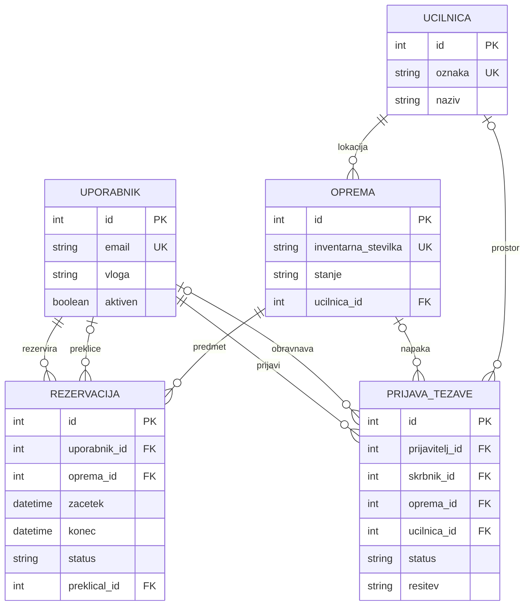

# Podatkovni model

## Zasnova podatkovne baze

Podatki bodo shranjeni v relacijski podatkovni bazi MySQL. Osnovni model za prvo delujočo različico vsebuje pet povezanih entitet: uporabnika, učilnico, opremo, rezervacijo in prijavo težave.

Vsaka entiteta je predstavljena s svojo tabelo. Povezave se vzpostavijo s tujimi ključi, zato se na primer pri rezervaciji shrani identifikator opreme, ne pa kopija njenega naziva.

Imena tabel in polj so zapisana brez šumnikov. V vseh tabelah je primarni ključ `id` tipa `INT`, ki se samodejno povečuje. Tabele bodo uporabljale InnoDB in kodiranje `utf8mb4`.

Legenda:

- **PK:** primarni ključ, ki enolično določa zapis.
- **FK:** tuji ključ, ki kaže na zapis v drugi tabeli.
- **UNIQUE:** vrednost se v tabeli ne sme ponoviti.
- **NULL:** podatek ni vnesen oziroma za zapis še ni določen.

## 1. Uporabnik – tabela `uporabnik`

Predstavlja osebo z dostopom do aplikacije. Uporabnik ima eno vlogo; dodatne pravice skrbnika in administratorja določa zaledje.

| Polje | Tip | Obvezno | Namen in omejitve |
| --- | --- | --- | --- |
| `id` | INT | Da | PK, samodejno povečevanje |
| `ime` | VARCHAR(100) | Da | Ime uporabnika |
| `priimek` | VARCHAR(100) | Da | Priimek uporabnika |
| `email` | VARCHAR(254) | Da | UNIQUE; uporablja se za prijavo |
| `geslo_hash` | VARCHAR(255) | Da | Varna zgoščena vrednost gesla; geslo se ne hrani v izvirni obliki |
| `vloga` | ENUM | Da | `ucitelj`, `ikt_skrbnik` ali `administrator` |
| `aktiven` | BOOLEAN | Da | Ali je račun aktiven; privzeto true |
| `ustvarjen_ob` | DATETIME | Da | Čas nastanka računa |

Administrator ustvari uporabnika in mu dodeli vlogo. Deaktiviran uporabnik se ne more prijaviti ali izvajati zaščitenih operacij. Njegove pretekle rezervacije in prijave ostanejo povezane z računom.

## 2. Učilnica – tabela `ucilnica`

Predstavlja učilnico oziroma šolski prostor. Tudi kabinet ali skladišče se lahko evidentira kot prostor v tej tabeli.

| Polje | Tip | Obvezno | Namen in omejitve |
| --- | --- | --- | --- |
| `id` | INT | Da | PK, samodejno povečevanje |
| `oznaka` | VARCHAR(30) | Da | UNIQUE; npr. `12` ali `KAB-IKT` |
| `naziv` | VARCHAR(100) | Da | Npr. »Računalniška učilnica« |
| `opis` | TEXT | Ne | Dodatni podatki o prostoru |

Učilnica omogoča evidentiranje lokacije opreme in prijavo težav, ki niso vezane na določeno napravo, na primer težave z omrežjem.

## 3. Oprema – tabela `oprema`

Predstavlja eno evidentirano enoto šolske opreme. Komplet tablic se lahko obravnava kot ena enota in se rezervira v celoti; posamezne tablice v takem kompletu v MVP niso ločene rezervacijske enote.

| Polje | Tip | Obvezno | Namen in omejitve |
| --- | --- | --- | --- |
| `id` | INT | Da | PK, samodejno povečevanje |
| `naziv` | VARCHAR(150) | Da | Npr. »Projektor 1« ali »Komplet 15 tablic« |
| `inventarna_stevilka` | VARCHAR(50) | Da | UNIQUE; enolična evidenčna oznaka enote oziroma kompleta |
| `vrsta` | VARCHAR(50) | Da | Npr. prenosnik, projektor, komplet tablic ali pametna tabla |
| `opis` | TEXT | Ne | Dodatni podatki o opremi |
| `stanje` | ENUM | Da | `uporabna` ali `nedelujoca`; privzeto `uporabna` |
| `ucilnica_id` | INT | Da | FK → `ucilnica.id`; običajna lokacija opreme |

Lokacija pomeni prostor, kjer je oprema običajno nameščena ali shranjena. Začasnega premika med rezervacijo MVP ne beleži. Stanje opreme ni isto kot njena razpoložljivost: uporabna oprema je lahko za določen termin že rezervirana.

## 4. Rezervacija – tabela `rezervacija`

Povezuje uporabnika, opremo in časovni interval uporabe. Vsaka rezervacija pripada enemu uporabniku in eni enoti opreme.

| Polje | Tip | Obvezno | Namen in omejitve |
| --- | --- | --- | --- |
| `id` | INT | Da | PK, samodejno povečevanje |
| `uporabnik_id` | INT | Da | FK → `uporabnik.id`; lastnik rezervacije |
| `oprema_id` | INT | Da | FK → `oprema.id`; rezervirana enota |
| `zacetek` | DATETIME | Da | Začetek uporabe |
| `konec` | DATETIME | Da | Konec uporabe; mora biti po začetku |
| `status` | ENUM | Da | `aktivna` ali `preklicana`; privzeto `aktivna` |
| `ustvarjena_ob` | DATETIME | Da | Čas nastanka rezervacije |
| `preklicana_ob` | DATETIME | Ne | Čas preklica; NULL pri aktivni rezervaciji |
| `preklical_id` | INT | Ne | FK → `uporabnik.id`; kdo je rezervacijo preklical |
| `razlog_preklica` | TEXT | Ne | Obvezen pri preklicu s strani skrbnika ali administratorja; pri lastnem preklicu učitelja ni obvezen |

Status `aktivna` pomeni, da rezervacija ni preklicana. Ali je prihodnja, poteka ali je že pretekla, se izračuna iz začetka, konca in trenutnega časa; ločen status »pretečena« zato ni potreben.

Opozorilo o nedelujoči opremi se izračuna iz trenutnega stanja povezane opreme. Ne hrani se kot dodatno polje rezervacije.

## 5. Prijava težave – tabela `prijava_tezave`

Predstavlja prijavljeno tehnično težavo in podatke o njeni obravnavi. Povezana je z opremo, učilnico ali obema.

| Polje | Tip | Obvezno | Namen in omejitve |
| --- | --- | --- | --- |
| `id` | INT | Da | PK, samodejno povečevanje |
| `prijavitelj_id` | INT | Da | FK → `uporabnik.id`; avtor prijave |
| `oprema_id` | INT | Pogojno | FK → `oprema.id`; lahko je NULL, če je izbrana učilnica |
| `ucilnica_id` | INT | Pogojno | FK → `ucilnica.id`; lahko je NULL, če je izbrana oprema |
| `naslov` | VARCHAR(150) | Da | Kratek povzetek težave |
| `opis` | TEXT | Da | Podrobnejši opis težave |
| `status` | ENUM | Da | `nova`, `v_obravnavi` ali `resena`; privzeto `nova` |
| `skrbnik_id` | INT | Ne ob oddaji | FK → `uporabnik.id`; odgovorni skrbnik, NULL pri novi prijavi |
| `ustvarjena_ob` | DATETIME | Da | Čas oddaje prijave |
| `prevzeta_ob` | DATETIME | Ne ob oddaji | Čas prvega prevzema prijave |
| `resitev` | TEXT | Ne ob oddaji | Obvezen neprazen opis ob zaključku |
| `resena_ob` | DATETIME | Ne ob oddaji | Obvezen čas zaključka rešene prijave |

Vsaj eno od polj `oprema_id` in `ucilnica_id` mora biti izpolnjeno. Če sta izpolnjeni obe, učilnica označuje prostor, kjer se je težava pojavila; ni nujno enaka običajni lokaciji opreme.

Prijava ni nujno povezana z rezervacijo. Učitelj lahko prijavi napako tudi na opremi, ki je ni rezerviral, ali težavo z omrežjem v učilnici.

## Povezave med entitetami

| Povezava | Razmerje | Pomen |
| --- | --- | --- |
| Učilnica → oprema | 1 : N | Učilnica ima lahko več enot opreme; vsaka enota ima eno običajno lokacijo. |
| Uporabnik → rezervacija | 1 : N | Uporabnik ima lahko več rezervacij; vsaka ima enega lastnika. |
| Oprema → rezervacija | 1 : N | Oprema ima lahko več rezervacij v različnih terminih. |
| Uporabnik → preklic rezervacije | 1 : N, neobvezno na strani rezervacije | Uporabnik lahko prekliče več rezervacij; nepreklicana rezervacija nima preklicatelja. |
| Uporabnik → prijava kot prijavitelj | 1 : N | Uporabnik lahko odda več prijav; vsaka ima enega prijavitelja. |
| Uporabnik → prijava kot skrbnik | 1 : N, neobvezno na strani prijave | Skrbnik lahko obravnava več prijav; nova prijava še nima skrbnika. |
| Oprema → prijava | 1 : N, neobvezno na strani prijave | Oprema ima lahko več prijav; prijava učilnične težave lahko nima izbrane opreme. |
| Učilnica → prijava | 1 : N, neobvezno na strani prijave | Učilnica ima lahko več prijav; prijava samo na opremi lahko nima izbrane učilnice. |

## Osnutek podatkovnega modela

Diagram prikazuje osnovne entitete in povezave. Celoten seznam polj je naveden v zgornjih tabelah.



## Omejitve in doslednost podatkov

### Osnovne omejitve

- E-poštni naslov uporabnika, oznaka učilnice in inventarna številka opreme so enolični.
- Obvezna besedilna polja ne smejo biti prazna ali vsebovati samo presledkov; to preveri zaledje.
- Tuji ključi morajo kazati na obstoječe zapise. Fizično brisanje povezanih uporabnikov, učilnic ali opreme se prepreči; v MVP administrator evidence dodaja in ureja, račune pa deaktivira.
- Rezervacije in prijave se ne brišejo ob preklicu ali zaključku, temveč se spremeni njihov status.
- Osnovne omejitve, kot so `zacetek < konec` in zahteva po opremi ali učilnici pri prijavi, se izrazijo tudi z omejitvami CHECK v shemi. Pravila glede uporabniških pravic in trenutnega časa preverja Flask.
- Datumi in časi se v poljih DATETIME hranijo po dogovorjeni konvenciji UTC. Zaledje pretvarja uporabniški vnos in prikaz glede na časovni pas Europe/Ljubljana; DATETIME sam ne hrani podatka o časovnem pasu.

### Preprečevanje prekrivanja rezervacij

Rezervaciji iste opreme se prekrivata, kadar velja:

```text
obstojeca.zacetek < nova.konec
in
obstojeca.konec > nova.zacetek
```

Pri preverjanju se upoštevajo samo rezervacije s statusom `aktivna`. Interval zato vključuje začetni trenutek, končnega pa ne; termina 9.00–10.00 in 10.00–11.00 sta dovoljena.

Enolični ključ na opremi in začetnem času ne zadošča za preprečevanje vseh prekrivanj. Predvidena rešitev je transakcija, ki najprej zaklene zapis izbrane opreme s `SELECT ... FOR UPDATE`, preveri njeno stanje in z zaklepajočim branjem preveri aktivne rezervacije. Nato rezervacijo shrani in potrdi transakcijo oziroma ob konfliktu transakcijo razveljavi. Vsi postopki ustvarjanja rezervacij morajo uporabljati isti način zaklepanja. Sprememba uporabnosti opreme se uskladi prek istega zapisa opreme.


### Stanja prijave

| Status | Zahtevani podatki |
| --- | --- |
| `nova` | Prijavitelj, naslov, opis, čas oddaje in oprema in/ali učilnica; skrbnik, čas prevzema, rešitev in čas zaključka so NULL. |
| `v_obravnavi` | Določen skrbnik in čas prvega prevzema; čas zaključka je NULL. |
| `resena` | Določen skrbnik, čas prevzema, neprazna rešitev in čas zaključka. |

Skrbnik mora imeti aktivno vlogo `ikt_skrbnik` ali `administrator` ob dodelitvi. Administrator lahko prijavo prerazporedi, pri čemer se čas prvega prevzema ohrani. Pred deaktivacijo računa ali spremembo njegove vloge mora administrator njegove odprte prevzete prijave prerazporediti. Prevzem prijave mora biti izveden atomarno, da dveh sočasnih prevzemov ni mogoče potrditi.

### Indeksi

Poleg primarnih in enoličnih ključev so predvideni indeksi za najpogostejše preglede:

- `rezervacija(oprema_id, status, zacetek)` za preverjanje razpoložljivosti;
- `rezervacija(uporabnik_id, zacetek)` za uporabnikov seznam rezervacij;
- `prijava_tezave(prijavitelj_id, ustvarjena_ob)` za uporabnikov seznam prijav;
- `prijava_tezave(status, ustvarjena_ob)` za pregled čakajočih prijav;
- `prijava_tezave(skrbnik_id, status)` za delo odgovornega skrbnika.

## Možnost kasnejše razširitve

Osnovni model podpira MVP. Pri nadaljnjem razvoju se lahko dodata tabeli `komentar_prijave` in `priponka_prijave`, povezani s prijavo in avtorjem. Za dejanski prevzem in vračilo opreme se rezervacija razširi s časoma prevzema in vračila. Za e-poštna obvestila se lahko doda evidenca pošiljanja, statistika pa se izračuna iz rezervacij in prijav.

Te razširitve niso del osnovnih petih tabel prve različice.
