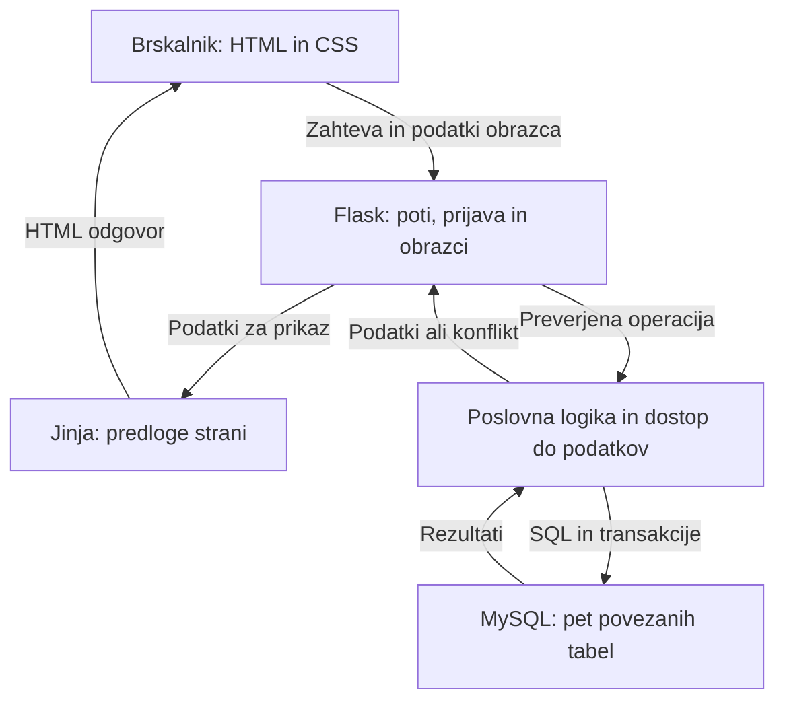

# Arhitektura in tehnološki sklad

## Tehnična zasnova

Rešitev bo spletna aplikacija z zaledjem v Pythonu in ogrodju Flask ter relacijsko podatkovno bazo MySQL. Uporabniški vmesnik bo izdelan s HTML, CSS in Jinja predlogami. Uporabnik bo aplikacijo uporabljal prek brskalnika.

Aplikacija bo zasnovana kot enoten projekt z moduli za prijavo, opremo, rezervacije, prijave težav in administracijo. Flask bo obdeloval zahteve in na strežniku sestavljal HTML-strani. JavaScript se lahko uporabi za manjše izboljšave uporabniške izkušnje, osnovni poteki pa bodo delovali z običajnimi obrazci.

## Glavni deli sistema

| Del | Odgovornost |
| --- | --- |
| Uporabniški vmesnik | Prikaz opreme, razpoložljivosti, rezervacij, prijav in obrazcev glede na pravice uporabnika |
| Flask poti in obrazci | Sprejem zahtev, preverjanje prijave in dovoljenj, preverjanje vhodnih podatkov ter priprava odgovorov |
| Poslovna logika | Pravila rezervacij, preprečevanje prekrivanj, prevzem in zaključek prijav ter vpliv nedelujoče opreme |
| Dostop do podatkov | Parametrizirane SQL-poizvedbe, upravljanje povezav in transakcij prek MySQL Connector/Python |
| Podatkovna baza MySQL | Trajno shranjevanje petih entitet, tuji ključi, enolične vrednosti, omejitve in indeksi |

Poslovna logika in dostop do podatkov sta modula znotraj iste Flask aplikacije, ne ločeni omrežni storitvi.

## Diagram arhitekture



## Komunikacija med deli sistema

Brskalnik pošilja zahteve Flask aplikaciji. Zahteve GET prikazujejo strani, zahteve POST pa izvajajo spremembe, kot so ustvarjanje rezervacije, preklic ali prevzem prijave. Spremembe podatkov se ne izvajajo prek zahtev GET.

Flask preveri uporabnika, njegove pravice, zaščitni žeton obrazca in vsebino vnosa. Nato pokliče poslovno logiko, ki prek podatkovnega modula dostopa do MySQL. Brskalnik nima neposrednega dostopa do baze ali njenih prijavnih podatkov.

Po uspešni oddaji obrazca aplikacija preusmeri uporabnika na ustrezno stran s potrditvenim sporočilom. Ob neveljavnem vnosu ali zasedenem terminu prikaže obrazec z razumljivo napako. Lokalni razvoj poteka prek HTTP na naslovu `127.0.0.1`; pri morebitni kasnejši objavi je predviden HTTPS.

### Primer ustvarjanja rezervacije

1. Učitelj izbere opremo in čas uporabe ter pošlje obrazec.
2. Flask preveri prijavo, aktivnost računa, žeton obrazca in veljavnost termina.
3. Poslovna logika začne transakcijo in zaklene zapis izbrane opreme.
4. Preveri uporabnost opreme in z zaklepajočim branjem preveri aktivne rezervacije glede na pravila iz podatkovnega modela.
5. Če ni konflikta, shrani rezervacijo in potrdi transakcijo; sicer transakcijo razveljavi in vrne razlog zavrnitve.
6. Uporabnik vidi potrditev ali sporočilo, da rezervacija ni mogoča.

Preverjanje razpoložljivosti pred oddajo je informativno. Končno preverjanje se vedno ponovi ob shranjevanju, ker se lahko razpoložljivost medtem spremeni.

## Podatkovna baza in dostop do podatkov

Uporabljena bo baza MySQL 8.4 z InnoDB in kodiranjem `utf8mb4`. Osnovne tabele so `uporabnik`, `ucilnica`, `oprema`, `rezervacija` in `prijava_tezave`; njihove povezave in omejitve so določene v `03-podatkovni-model.md`.

Za dostop iz Pythona bo uporabljena knjižnica `mysql-connector-python`. SQL-poizvedbe bodo zapisane v podatkovnem modulu. Vrednosti uporabniškega vnosa bodo posredovane kot parametri poizvedbe, ne z lepljenjem besedila v SQL. Povezava se po koncu zahteve zapre; ob napaki se nepotrjena transakcija razveljavi.

Rezervacije iste opreme se usklajujejo z zaklepanjem zapisa opreme. Prevzem prijave se izvede s pogojno posodobitvijo samo nove, še neprevzete prijave ali z zaklepanjem njenega zapisa v transakciji. Zaledje preveri uspešnost operacije, da dveh prevzemov ni mogoče potrditi.

Aplikacija uporablja poseben MySQL račun z dovoljenji za branje in spreminjanje podatkov svoje baze. Ustvarjanje sheme izvede razvijalec z računom, ki ima potrebna dodatna dovoljenja. Geslo baze je nastavitveni podatek zunaj izvorne kode.

Datumi in časi se hranijo v UTC, uporabniku pa prikazujejo v časovnem pasu Europe/Ljubljana. Pretvorbo izvaja zaledje, skladno s podatkovnim modelom.

## Avtentikacija in upravljanje uporabnikov

### Prijava in seja

Za upravljanje prijavljene seje bo uporabljena razširitev Flask-Login. Uporabnik se prijavi z e-poštnim naslovom in geslom. Zaledje poišče račun, preveri, ali je aktiven, in preveri geslo glede na shranjeno zgoščeno vrednost. Za pripravo in preverjanje zgoščene vrednosti se uporabita funkciji `generate_password_hash` in `check_password_hash` iz Werkzeug.

Po prijavi se v podpisani seji hrani identifikator uporabnika; geslo se ne hrani v seji. Podpis seje temelji na naključnem `SECRET_KEY`. Seja se ob odjavi zaključi. Pri zaščitenih zahtevah se uporabnik ponovno naloži iz baze, da deaktivacija računa ali sprememba vloge učinkuje tudi na že prijavljenega uporabnika.

### Pravice uporabnikov

Flask-Login upravlja prijavo, pravice treh vlog pa določa lastna koda aplikacije. Zaledje pri vsaki operaciji preveri vlogo in po potrebi lastništvo rezervacije ali prijave.

- Učitelj upravlja svoje rezervacije in pregleduje svoje prijave.
- IKT skrbnik ima tudi pravice učitelja ter obravnava prijave in upravlja uporabnost opreme.
- Administrator ima tudi pravice obeh drugih vlog ter upravlja račune in osnovne evidence.

Podrobne pravice in izjeme veljajo skladno z `02-funkcionalnosti-in-obseg.md`. Nepooblaščen dostop se zavrne tudi pri neposrednem pošiljanju zahteve zaledju.

### Računi in obrazci

Javna registracija ni predvidena. Prvi administratorski račun bo ustvarjen z lokalnim ukazom, nadaljnje račune pa ustvarja administrator v aplikaciji. Ob ustvarjanju računa določi začetno geslo in vlogo. Samodejna ponastavitev gesla po e-pošti ni del MVP.

Za obrazce in zaščito pred CSRF bo uporabljena knjižnica Flask-WTF. Zahteve, ki spreminjajo podatke, morajo vsebovati veljaven zaščitni žeton. Predloge bodo uporabljale običajno samodejno ubežanje uporabniških besedil; opisov težav se ne obravnava kot zaupanja vrednega HTML.

## Tehnološki sklad

| Področje | Tehnologija oziroma orodje | Namen |
| --- | --- | --- |
| Frontend | HTML in CSS | Vsebina, obrazci, preglednice ter prilagodljiv prikaz strani |
| Predloge | Jinja | Sestavljanje HTML-strani s podatki iz zaledja |
| Backend | Python in Flask | Poti, obdelava zahtev in poslovna pravila |
| Podatkovna baza | MySQL 8.4, InnoDB | Relacijsko shranjevanje podatkov in transakcije |
| Povezava z bazo | MySQL Connector/Python | Parametrizirane SQL-poizvedbe in transakcije |
| Prijava | Flask-Login | Upravljanje uporabniške seje |
| Gesla | Werkzeug | Priprava in preverjanje varnih zgoščenih vrednosti |
| Obrazci | Flask-WTF | Preverjanje vnosa in zaščita pred CSRF |
| Nastavitve za razvoj | Okoljske spremenljivke in python-dotenv | Lokalno nalaganje nastavitev iz datoteke `.env` |
| Lokalni razvoj | Python venv in urejevalnik kode | Ločeno okolje projekta in razvoj aplikacije |
| Delo z bazo | MySQL Workbench ali odjemalec mysql | Ustvarjanje baze in pregled podatkov |
| Verzije kode | Git in GitHub | Sledenje spremembam in dokumentacija projekta |
| Preverjanje | pytest in Flask testni odjemalec | Preverjanje pravil, pravic in delovnih procesov |

Točne različice Python knjižnic bodo ob začetku implementacije izbrane glede na združljivost in zapisane v `requirements.txt`, da bo namestitev ponovljiva.

## Predvidena organizacija projekta

| Pot | Vsebina |
| --- | --- |
| `app/__init__.py` | Funkcija `create_app`, nalaganje nastavitev in registracija modulov |
| `app/auth.py` | Prijava, odjava in nalaganje uporabnika |
| `app/oprema.py` | Pregled opreme in razpoložljivosti |
| `app/rezervacije.py` | Obrazci in poti za rezervacije ter preklice |
| `app/prijave.py` | Oddaja, pregled, prevzem in zaključek prijav |
| `app/admin.py` | Upravljanje uporabnikov, učilnic in opreme |
| `app/services/` | Poslovna pravila in transakcijski postopki |
| `app/db.py` | Upravljanje povezave z MySQL |
| `app/repositories/` | SQL-poizvedbe za posamezne entitete |
| `app/templates/` | Jinja predloge strani |
| `app/static/` | CSS in morebitni JavaScript |
| `sql/001-schema.sql` | Začetna shema baze; nadaljnje spremembe se dodajajo kot oštevilčene skripte |
| `tests/` | Testi pomembnih pravil in delovnih procesov |
| `docs/` | Dokumentacija zasnove, wireframes in ADR |
| `requirements.txt` | Knjižnice in njihove različice |
| `.env.example` | Primer imen nastavitev brez dejanskih skrivnosti |
| `.gitignore` | Izključitev lokalnih nastavitev, virtualnega okolja in drugih začasnih datotek |
| `README.md` | Navodila za namestitev, pripravo baze, zagon in preverjanje |

To je načrt organizacije. Navedeni moduli, ukazi in SQL-skripte bodo nastali pri implementaciji.

## Način lokalnega zagona

### Predvideni postopek

1. Prenese repozitorij in odpre terminal v njegovi korenski mapi.
2. Ustvari in aktivira virtualno okolje Python.
3. Namesti knjižnice iz `requirements.txt`.
4. V MySQL ustvari bazo `solski_ikt`, izvede `sql/001-schema.sql` in pripravi račun za aplikacijo.
5. Kopira `.env.example` v lokalno `.env` ter vnese svoje nastavitve.
6. S predvidenim ukazom `flask --app app create-admin` ustvari prvega administratorja; ukaz podatke in geslo zahteva interaktivno.
7. Zažene razvojni strežnik in odpre aplikacijo v brskalniku.

Primer namestitve in zagona v Windows PowerShell po dokončanju implementacije:

```powershell
python -m venv .venv
.\.venv\Scripts\Activate.ps1
python -m pip install -r requirements.txt
# Pred naslednjim korakom pripravi bazo in datoteko .env.
flask --app app create-admin
flask --app app run --debug
```

Aplikacija bo pri običajnem lokalnem zagonu dostopna na `http://127.0.0.1:5000`.

### Nastavitve okolja

| Nastavitev | Namen |
| --- | --- |
| `SECRET_KEY` | Naključni skrivni ključ za podpis seje in zaščito obrazcev |
| `DB_HOST` | Naslov MySQL strežnika, lokalno praviloma `127.0.0.1` |
| `DB_PORT` | Vrata MySQL strežnika, praviloma `3306` |
| `DB_NAME` | Ime baze, predvidoma `solski_ikt` |
| `DB_USER` | Uporabniški račun aplikacije za dostop do baze |
| `DB_PASSWORD` | Geslo tega računa |

Datoteka `.env` se ne vključi v Git. V repozitoriju je samo `.env.example` brez dejanskih gesel in ključev. Aplikacija ob manjkajočih obveznih nastavitvah vrne jasno napako namesto uporabe vnaprej določenega skrivnega ključa.

Razvojni strežnik in način debug sta namenjena lokalnemu razvoju. Morebitna kasnejša objava zahteva produkcijski WSGI strežnik, izklop debug načina, HTTPS in ustrezne nastavitve sejnih piškotkov.

## Arhitekturne odločitve

| Odločitev | Razlog |
| --- | --- |
| Flask in Python | Izbrani sklad omogoča jasen prikaz obdelave zahtev in samostojno izvedbo pravil rezervacij ter prijav. |
| Enotna aplikacija z ločenimi moduli | Obseg ene šole ne zahteva ločenih storitev; moduli ohranijo preglednost kode. |
| HTML in Jinja predloge | Obrazci in preglednice zadostujejo za MVP; podatki in uporabniški vmesnik se povežejo znotraj enega projekta. |
| MySQL | Entitete imajo jasne relacijske povezave; transakcije so pomembne za rezervacije in prevzem prijav. |
| Neposredne parametrizirane SQL-poizvedbe | Omogočajo pregledno delo z izbrano bazo in razumevanje poizvedb; poizvedbe ostanejo ločene od poti in predlog. |
| Sejna prijava s Flask-Login | Aplikacija se uporablja prek brskalnika; lasten sistem žetonov za API ni potreben za predvidene poteke. |
| Brez javne registracije | Dostop je namenjen zaposlenim ene šole, račune pa upravlja administrator. |
| Transakcije pri ključnih operacijah | Preverjanje in zapis morata skupaj preprečiti dvojne rezervacije ali dvojni prevzem prijave. |

## Preverjanje ob implementaciji

Ključna pravila bodo preverjena na ločeni testni bazi MySQL, da se preveri tudi dejansko vedenje transakcij in omejitev. Testi ne bodo uporabljali šolskih osebnih podatkov.

Preverijo se veljavni in prekrivajoči termini, sočasni rezervaciji iste opreme, blokada nedelujoče opreme, lastništvo rezervacij, dovoljenja vlog, sočasni prevzem prijave in zaključek brez zapisane rešitve. Ročno se preverijo še osnovni uporabniški poteki, sporočila ob napakah in prikaz na ožjem zaslonu.

Testni ukaz bo `python -m pytest`, podrobna priprava testne baze pa bo opisana v README ob implementaciji. Ta dokument predstavlja zasnovo; aplikacija in testi še niso izdelani.

## Referenčna dokumentacija

- [Flask: priprava aplikacije](https://flask.palletsprojects.com/en/stable/tutorial/factory/)
- [Flask: objava aplikacije](https://flask.palletsprojects.com/en/stable/tutorial/deploy/)
- [Flask-Login: upravljanje uporabniških sej](https://flask-login.readthedocs.io/en/latest/)
- [Flask-WTF: zaščita pred CSRF](https://flask-wtf.readthedocs.io/en/latest/csrf/)
- [MySQL Connector/Python: parametrizirane poizvedbe](https://dev.mysql.com/doc/connectors/en/connector-python-api-mysqlcursor-execute.html)
