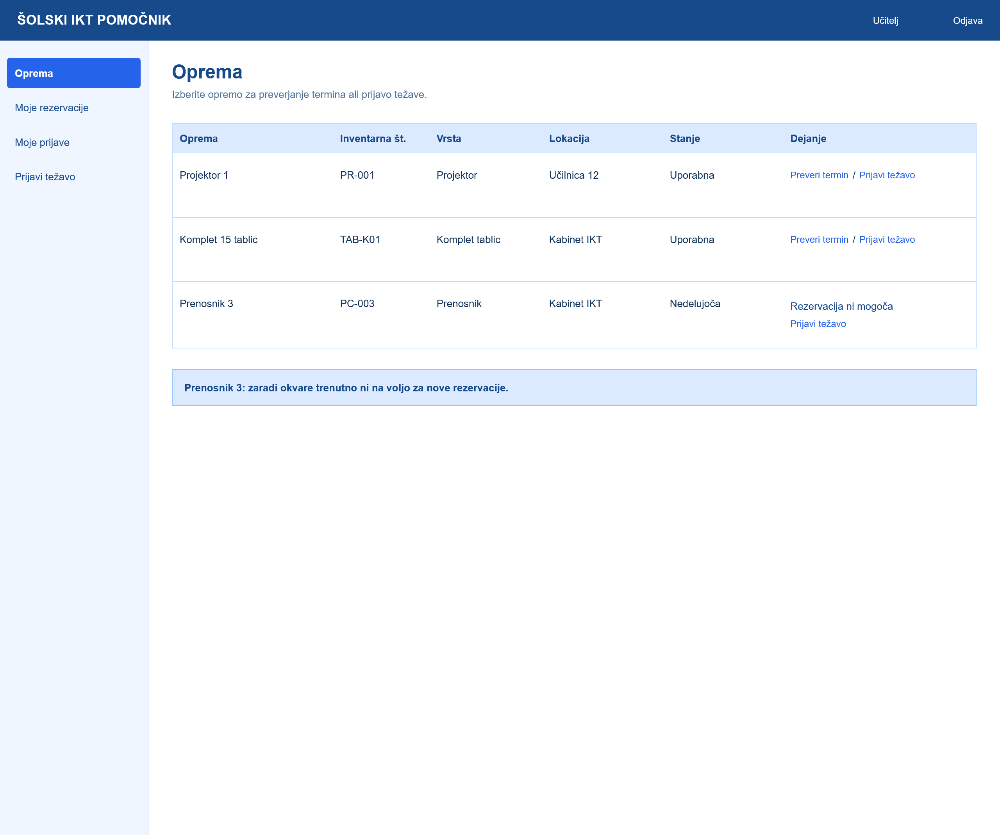
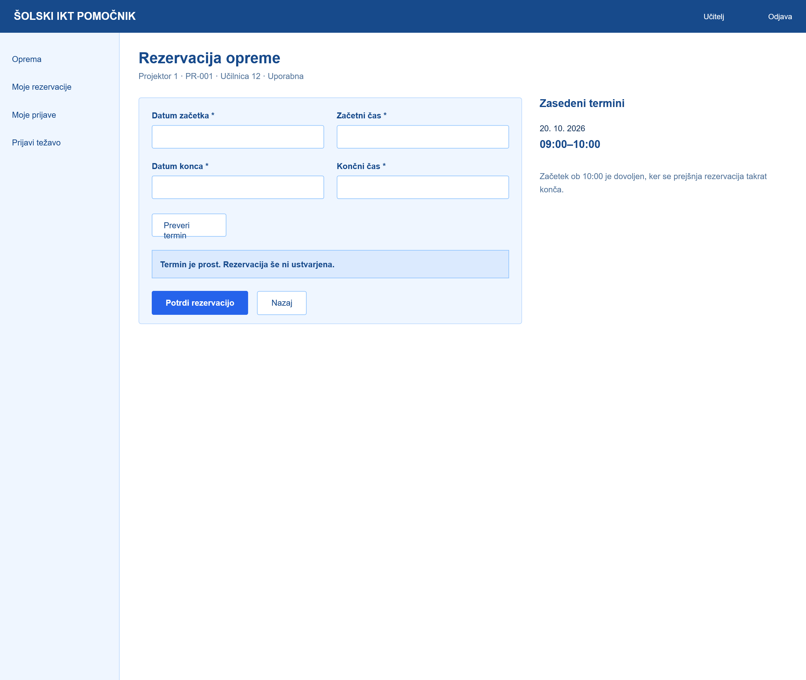
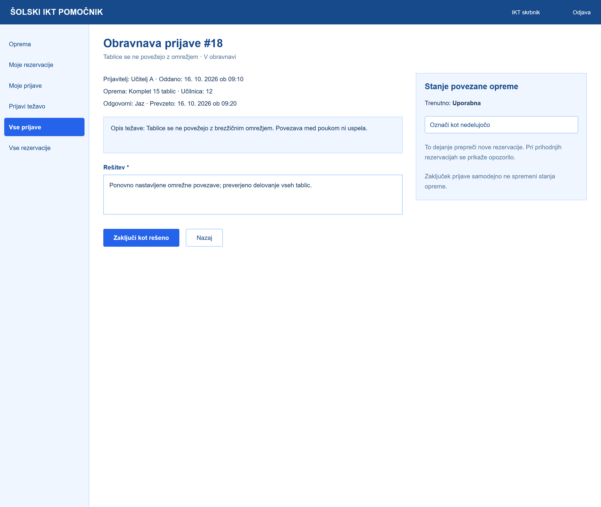
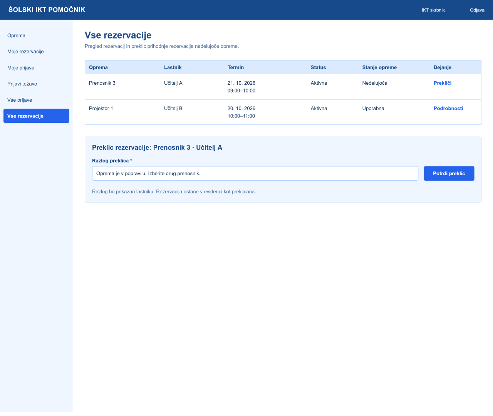
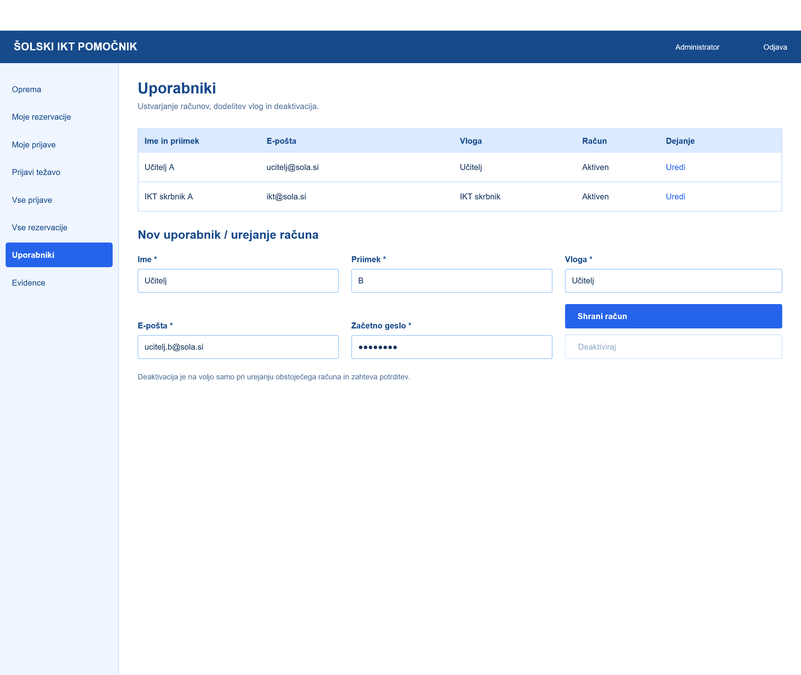

# Wireframes

## 1. Pregled opreme

Zaslon prikazuje seznam šolske IKT-opreme z inventarnimi številkami, vrsto, lokacijo in stanjem. Učitelj lahko preveri termin za rezervacijo ali prijavi težavo. Pri nedelujoči opremi rezervacija ni mogoča.

## 2. Rezervacija opreme

Zaslon omogoča učitelju rezervacijo izbrane šolske IKT opreme. Uporabnik vnese datum in uro začetka ter konca rezervacije. S klikom na gumb **Preveri termin** preveri, ali je oprema v izbranem terminu prosta. Na desni strani so prikazani že zasedeni termini, kar uporabniku olajša načrtovanje rezervacije. Če je termin prost, lahko uporabnik rezervacijo potrdi s klikom na gumb **Potrdi rezervacijo**. V primeru zasedenega termina sistem uporabnika opozori in mu omogoči izbiro drugega termina.

## 3. Obravnava prijave

Zaslon omogoča IKT skrbniku obravnavo prijavljene tehnične težave. Prikazani so podatki o prijavi, prijavitelju, opremi in opisu težave. Skrbnik lahko vpiše izvedene ukrepe in rešitev ter s klikom na gumb Zaključi kot rešeno zaključi prijavo. Na desni strani lahko spremeni stanje povezane opreme v Nedelujoča, s čimer prepreči nove rezervacije te opreme. Zaključek prijave ne spremeni samodejno stanja opreme.

## 4. Vse rezervacije – pogled IKT-skrbnika

IKT-skrbnik vidi rezervacije, uporabnike, termine ter stanje rezervirane opreme. Če oprema ne deluje, lahko prekliče rezervacijo, vnese obvezen razlog in o preklicu obvesti lastnika rezervacije. Preklicana rezervacija ostane zabeležena v evidenci.

## 5. Urejanje uporabnikov

Zaslon omogoča administratorju upravljanje uporabniških računov v aplikaciji Šolski IKT pomočnik. V tabeli so prikazani uporabniki, njihovi e-poštni naslovi, dodeljene vloge in stanje računov. Administrator lahko ustvari nove uporabniške račune, ureja podatke obstoječih uporabnikov ter jim dodeljuje vloge (učitelj, IKT skrbnik ali administrator). Omogočena je tudi deaktivacija obstoječega računa, ki zahteva dodatno potrditev. S tem je zagotovljen nadzor nad dostopom uporabnikov do posameznih funkcionalnosti sistema.

Za izdelavo wireframov sem uporabil Figmo.
